# HRIS Mobile

Aplikasi mobile HRIS untuk Android dan iOS dengan Expo Router. Backend API
berada di repository <a href="https://github.com/Iemaduddin/hris">HRIS</a>.

## Tech stack

- Expo SDK 57 + Expo Router
- TanStack Query untuk data fetching
- Zustand untuk state sesi
- expo-secure-store untuk token dan device ID
- expo-location untuk presensi berbasis GPS
- expo-notifications untuk push notification dan deep link

## Fitur

- Login dan sesi tersimpan aman
- Tabs: Beranda, Presensi, Pengajuan, Jadwal, dan Lainnya
- Profil, pengaturan, dan ubah kata sandi
- **Presensi GPS**: check-in/out dalam radius kantor dan riwayat per hari
- **Pengajuan**: cuti, dinas, lembur, lampiran foto, detail, dan timeline
- **Koreksi presensi**: usulan waktu koreksi dengan bukti opsional
- **Tukar shift**: usulan pertukaran shift dengan pasangan
- **Perjalanan Dinas**: pengajuan uang muka dan pengiriman LPJ dengan bukti
- **Reimbursement**: klaim dengan foto struk
- **Kasbon**: simulasi cicilan dan pengajuan kasbon
- **Update data**: usulan perubahan data pribadi dan keluarga
- **Pengumuman**: melihat dan menerbitkan pengumuman sesuai role
- **Notifikasi**: inbox notifikasi dan deep link ke detail pengajuan
- **Onboarding**: melihat detail onboarding karyawan baru
- **Slip gaji**: daftar dan detail berdasarkan nomor slip
- **Approval**: menyetujui atau menolak pengajuan sesuai role
- **Kalender, tim, dan pengaturan**: kalender kerja, tim, dan pengaturan
- **Push notification**: notifikasi approval dengan deep link ke detail
## Preview

### Login & Beranda
<p>
  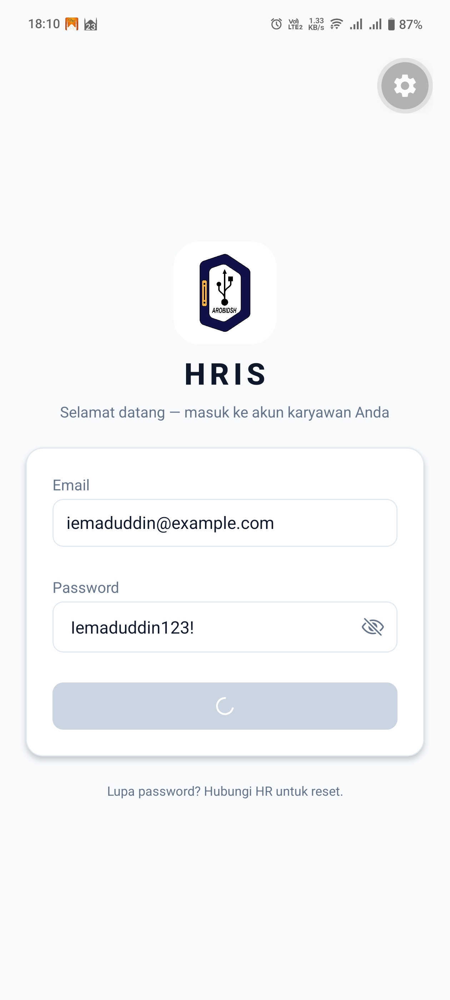
  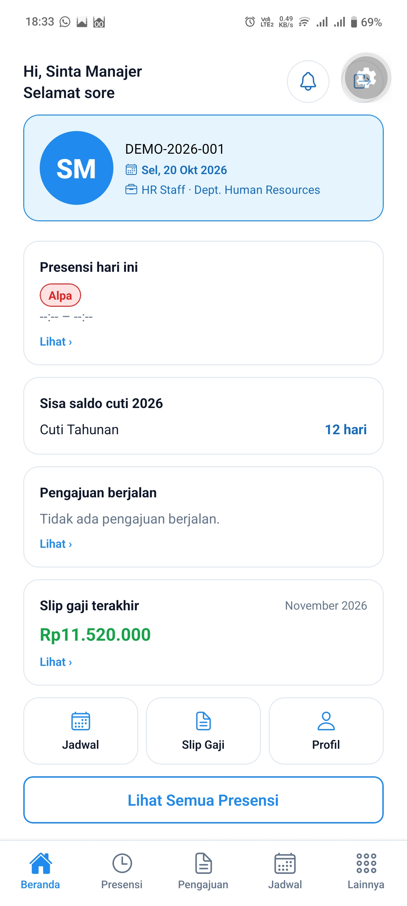
</p>

### Presensi GPS, riwayat dan slip gaji
<p>
 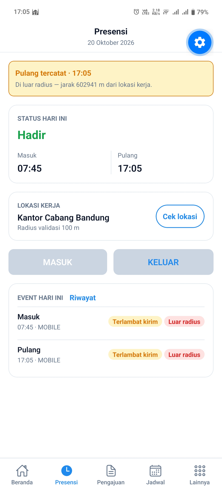
 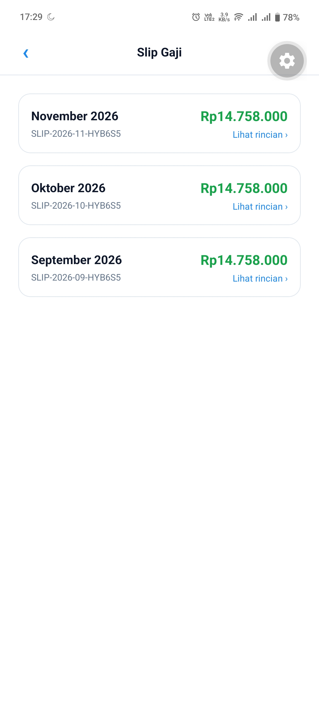
</p>

### Koreksi presensi dan Tukar Shift

<p>
  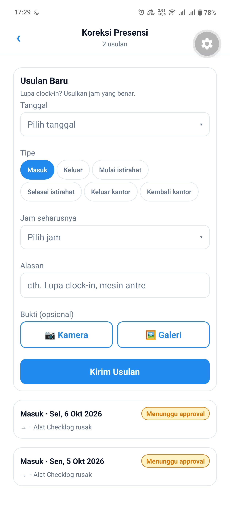
  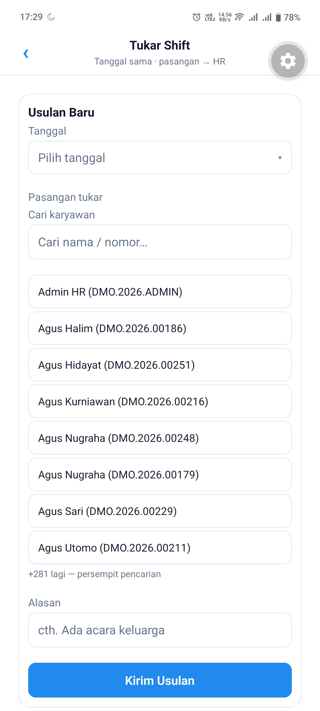
</p>

### Pengajuan & Approval

<p>
  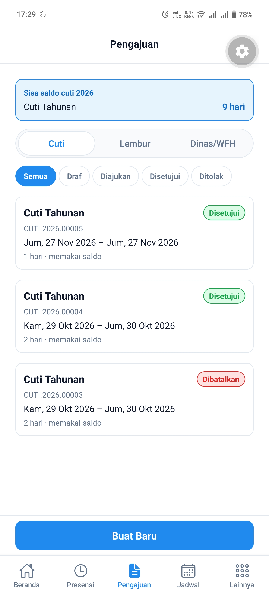
  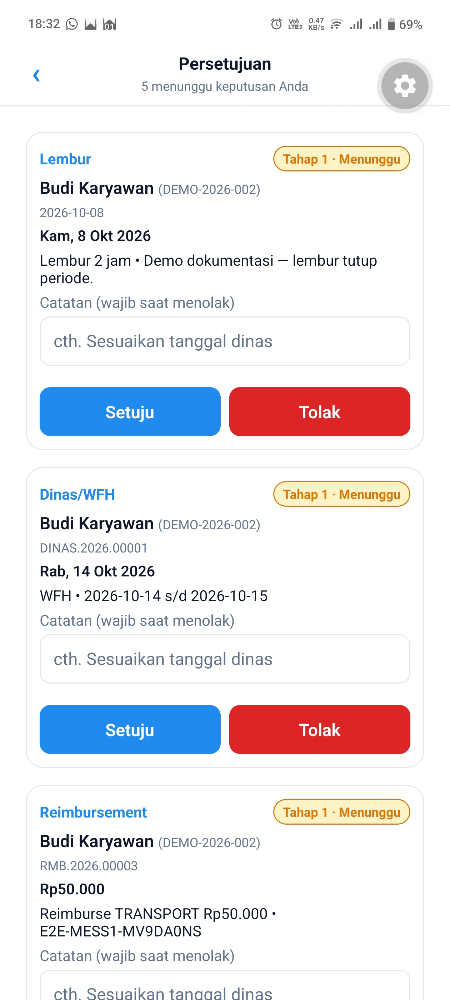
</p>

### Kalender & Jadwal

<p>
  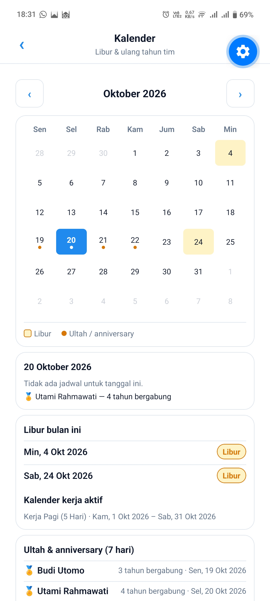
  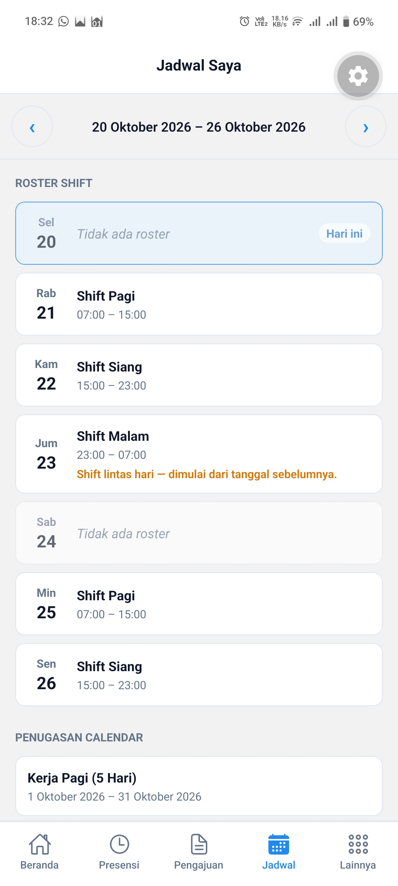
</p>


### Pengumuman 
  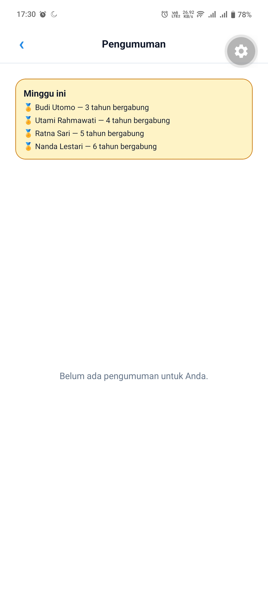

### Profil, Tim dan settings

<p>
  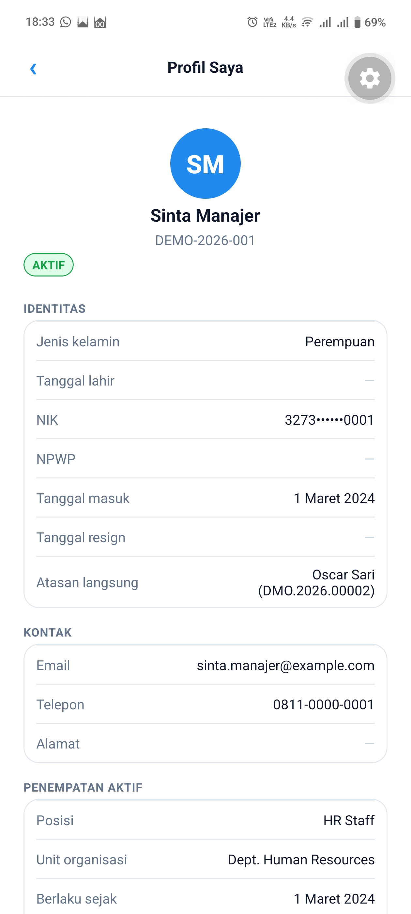
  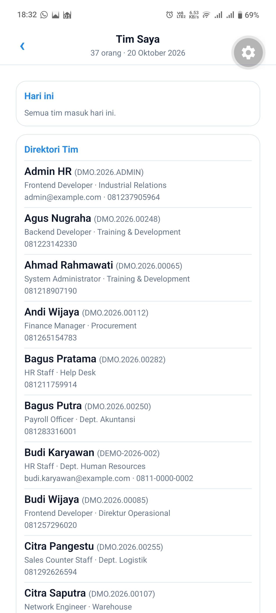
  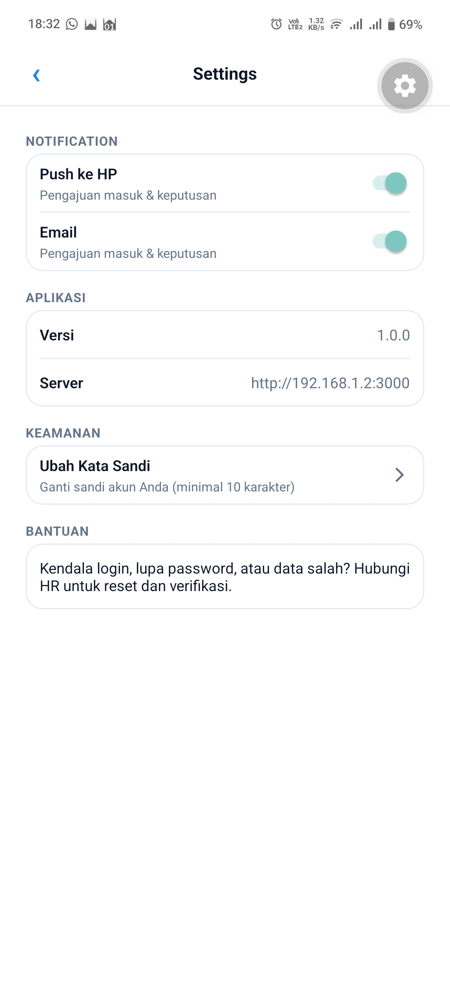
</p>

### Notifikasi
<p>
  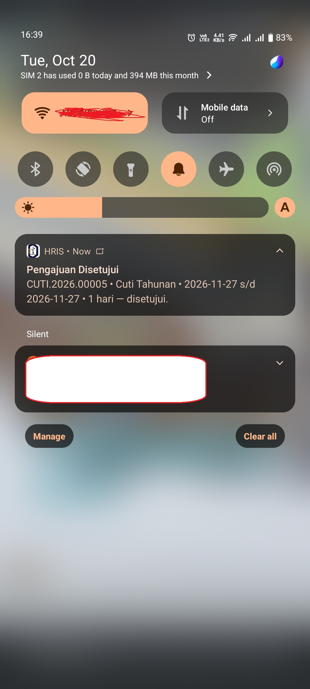
  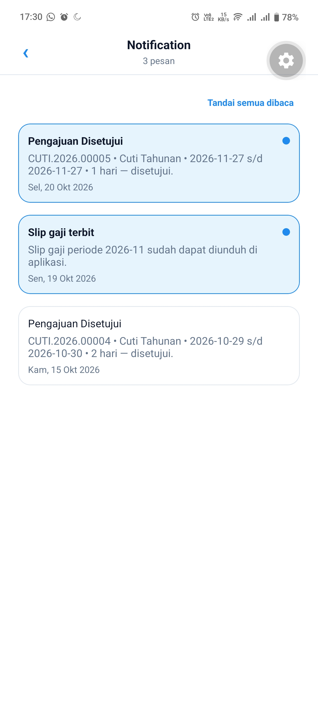
</p>

### Menu Lainnya
  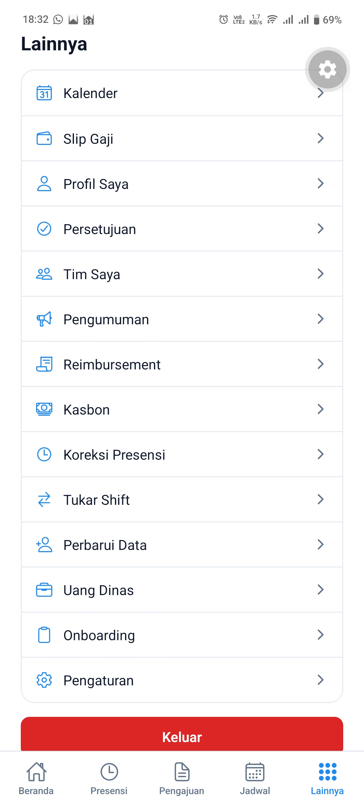


## Prasyarat

- Node.js 22
- Backend `hris` sedang berjalan
- Emulator Android/iOS atau HP fisik dalam satu jaringan dengan PC

## Konfigurasi (`.env`)

```env
EXPO_PUBLIC_API_URL=http://192.168.100.16:3000
```

Gunakan IP LAN PC, bukan `localhost`, saat aplikasi dijalankan pada HP fisik.
Cek IP dengan `ipconfig`, sesuaikan port backend, lalu restart Expo setelah
mengubah `.env`.

`google-services.json` untuk FCM Android sudah disertakan di repository agar
build Android dan EAS berjalan. File ini berisi konfigurasi client Firebase,
bukan service account. Jika memakai project Firebase lain, ganti file tersebut
dengan milikmu.

## Cara menjalankan

```powershell
npm install
npx expo start --port 8081
```

- Tekan `a` untuk emulator Android atau scan QR dari HP.
- Gunakan development build untuk modul native:
  `npx expo run:android` atau `npx expo run:ios`.
- Untuk emulator Android, gunakan `adb reverse tcp:8081 tcp:8081` bila
  diperlukan.
- Jika port Metro bentrok, gunakan `npx expo start --port 8082`.

Backend default menggunakan port `3000`, sedangkan Metro menggunakan `8081`.

Akun demo mengikuti seed backend:

| Email | Password | Role |
|---|---|---|
| `employee@example.com` | `Employee123!` | Employee |
| `admin@example.com` | `Admin123!` | Admin HR |

Akun demo lain (`manager`, `finance`, `superadmin`) tersedia di
`prisma/seed.ts` pada repository `hris`.

## Skrip

| Perintah | Kegunaan |
|---|---|
| `npx expo start` | Menjalankan development server dan Metro |
| `npx expo run:android` / `run:ios` | Build dan memasang development client |
| `npx expo lint` | Menjalankan lint |
| `npx tsc --noEmit` | Menjalankan type-check |
| `npx expo-doctor` | Mendiagnosis dependensi Expo |

## Build rilis (EAS)

```bash
npx eas-cli@latest build --profile development
npx eas-cli@latest build --profile production
```

Project ID EAS terdaftar di `app.json` pada `extra.eas.projectId`.

Profil `preview` dan `production` di `eas.json` masih memakai
`EXPO_PUBLIC_API_URL=https://GANTI-DOMAIN-ANDA`. Ganti nilai tersebut dengan
domain backend production sebelum build rilis.

